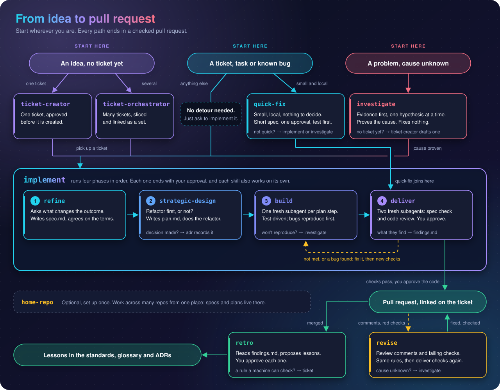

# skills

Skills library for Claude Code, packaged as a plugin marketplace.

## Install

```
/plugin marketplace add happsie/skills
/plugin install happsie@happsie-skills
```

Update later with `/plugin marketplace update happsie-skills`.

## Workflow

How the skills fit together. `implement` runs `refine`, `strategic-design`, the build and `deliver` in order, and each of them also works on its own. `quick-fix` is the short path for a small, local change: a short spec, one approval, a test first, then the same checks in `deliver`. `deliver` has two fresh subagents look at the diff, one against the spec and one as a code reviewer, and describes the change (how it changed, what happens when it is deployed, whether it can be reverted) before you approve the code. After the pull request is open, `revise` handles review comments and failing checks under the same rules, and once it is merged `retro` turns what was found along the way into lessons for the coding standards, the glossary and the ADRs. The code is written in a git worktree per piece of work, so your own checkout stays free while it builds.



## Add a skill

Skills live in `plugins/happsie/skills/`. Create `plugins/happsie/skills/<name>/SKILL.md` with `name` and `description` frontmatter. It shows up as `happsie:<name>`. Add it to `docs/workflow.py` and regenerate the flowchart (see `CLAUDE.md`).

## Add a plugin

Create `plugins/<plugin>/.claude-plugin/plugin.json` and list it in `.claude-plugin/marketplace.json`.

## Develop locally

```
claude plugin validate .
/plugin marketplace add /path/to/this/repo
```
